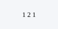

# Introducción

Contar bien exige método. Texto con *cursiva*, **negrita** y una fórmula en línea
$P(n, r) = \frac{n!}{(n-r)!}$ dentro del párrafo.

## Fórmulas de bloque

$$
\binom{12}{5} - \binom{9}{5} = 666
$$

## Tablas

| Concepto    | Notación        | En palabras                    |
|:------------|:---------------:|:-------------------------------|
| Permutación | $P(n,r)$        | Ordenaciones de r entre n.     |
| Combinación | $\binom{n}{r}$  | Subconjuntos de r entre n.     |

## Figuras

{width=40%}

## Listas

1. Resolver cuatro problemas de conteo.
2. Verificar cada resultado enumerando los casos.
